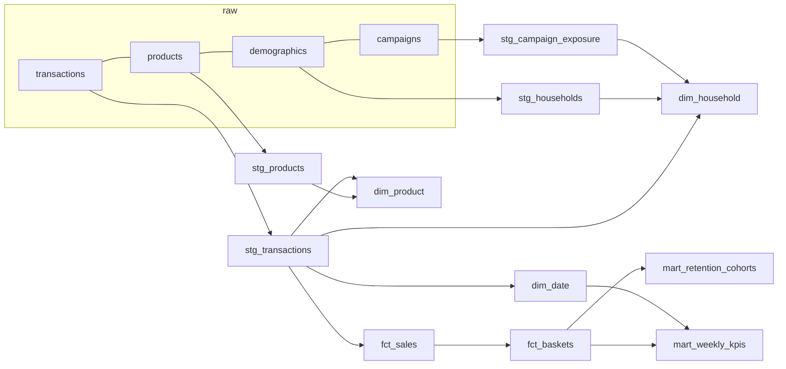
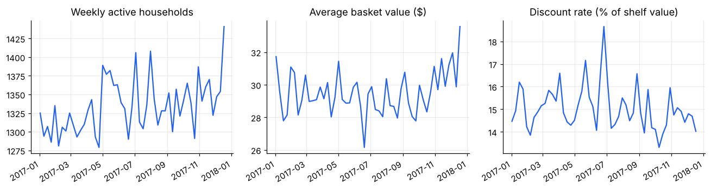
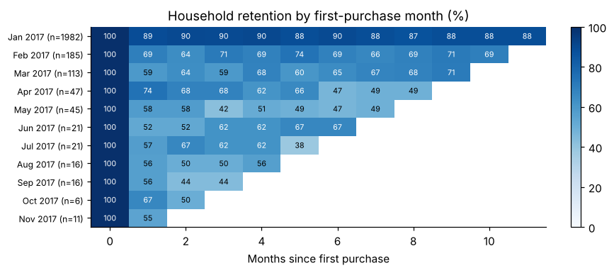

# Retail Analytics Warehouse — dbt + DuckDB

A small, production-style analytics warehouse for grocery retail built with **dbt** on **DuckDB**, using dunnhumby's
*The Complete Journey* (1.47M transaction lines, 2,469 households, 92K products, 2017). Raw tables are loaded into a
`raw` schema, cleaned in **staging** views, and modeled into a **star schema** plus KPI marts — with **24 automated data tests**.



## Model layers
| Layer | Models | Grain |
|---|---|---|
| Staging (views) | `stg_transactions`, `stg_products`, `stg_households`, `stg_campaign_exposure` | 1:1 with source, typed & renamed |
| Dimensions | `dim_product`, `dim_household`, `dim_date` | product / household / day |
| Facts | `fct_sales` (1.46M rows), `fct_baskets` (155.5K rows) | basket line / basket |
| Marts | `mart_weekly_kpis`, `mart_retention_cohorts` | week / cohort-month × months since |

## Data quality
`dbt build` runs **24 tests — all passing**: `unique` / `not_null` keys, `accepted_values` on brand type,
`relationships` from facts to every dimension, and two custom tests — basket totals must reconcile to line-level sales,
and no negative sales.

The relationships test caught a real source issue: **3 product IDs (32 basket lines) are missing from the product master**.
Instead of silently dropping those sales, `dim_product` adds them as `UNKNOWN` members (`is_unknown_member = true`).

## What the marts show (2017)
| Metric | Value |
|---|---|
| Weekly active households | **~1,334** of 2,469 (54%) |
| Average basket value | **$29.50** |
| Discount rate (% of shelf value) | **15.1%** |
| Households active ≥ 26 of 52 weeks | **56%** |
| Sales share of top 20% households | **55%** |
| January cohort retention, month 1 → month 11 | **89% → 88%** |

| | |
|---|---|
|  |  |

## How to run
```bash
pip install -r requirements.txt
python scripts/load_raw.py            # loads raw tables into warehouse.duckdb
dbt build --profiles-dir .            # builds staging, marts and runs all tests
jupyter nbconvert --to notebook --execute metrics_report.ipynb
```

## Files
`models/staging/`, `models/marts/` (SQL + `schema.yml` tests) · `tests/` (custom SQL tests) · `scripts/load_raw.py` ·
`metrics_report.ipynb` (report on the marts) · `charts/`

**Tools:** dbt, DuckDB, SQL, Python, data testing, dimensional modeling
